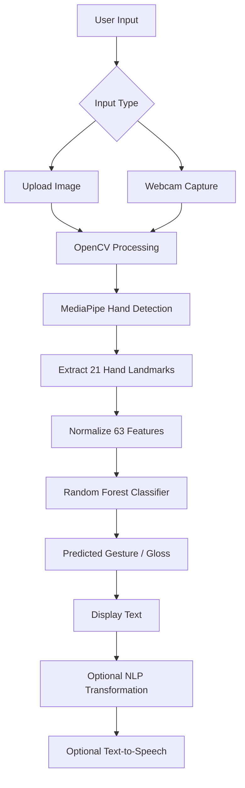

# SANDESH – AI-Powered Indian Sign Language Recognition and Communication System

<p align="center">
  <strong>Every Gesture Has a Voice.</strong>
</p>

<p align="center">
  An AI-powered prototype that recognizes Indian Sign Language (ISL) hand gestures and converts them into meaningful text and optional speech.
</p>

---

## About the Project

**SANDESH** is an Artificial Intelligence and Computer Vision-based project designed to reduce communication barriers between Indian Sign Language (ISL) users and people who do not understand sign language.

The system uses hand landmark detection and machine learning to identify supported hand gestures from webcam input or uploaded images. Recognized gestures are converted into readable text, with optional text-to-speech functionality.

Our goal is to explore how accessible AI technology can make everyday communication more inclusive.

## Key Features

- **Image-Based Recognition:** Upload an image containing a supported hand gesture.
- **Webcam-Based Input:** Capture hand gestures through a webcam.
- **Hand Landmark Detection:** Extract 21 hand landmarks using MediaPipe.
- **Gesture Classification:** Predict supported gestures using a trained Random Forest model.
- **Confidence Score:** Display the model's prediction confidence.
- **Text Conversion:** Display recognized gesture labels as readable text.
- **Optional NLP Processing:** Experimental gloss-to-English text transformation using FLAN-T5-small.
- **Text-to-Speech:** Convert generated text into speech using pyttsx3.
- **Dataset Collection:** Collect and organize gesture samples for model training.
- **Model Evaluation:** Evaluate classification performance using appropriate machine learning metrics.

## System Workflow



## Technology Stack

| Category | Technologies |
|---|---|
| Programming Language | Python 3.10 |
| User Interface | Streamlit |
| Computer Vision | OpenCV |
| Hand Detection | MediaPipe |
| Data Processing | NumPy, Pandas |
| Machine Learning | Scikit-learn |
| NLP | Hugging Face Transformers, FLAN-T5-small |
| Deep Learning Framework | PyTorch |
| Speech Output | pyttsx3 |
| Evaluation | Scikit-learn, SacreBLEU |
| Testing | Pytest |

## Project Structure

```text
SANDESH/
│
├── app.py
├── requirements.txt
│
├── signbridge/
│   ├── landmarks.py
│   ├── classifier.py
│   ├── translator.py
│   └── speech.py
│
├── scripts/
│   ├── collect_dataset.py
│   ├── train_model.py
│   └── evaluate.py
│
├── data/
│   └── README.md
│
├── models/
│   └── README.md
│
├── docs/
│   ├── SRS.md
│   ├── TEST_CASES.md
│   ├── TEAM_PLAN.md
│   └── uml/
│       ├── use_case.puml
│       ├── activity.puml
│       ├── sequence.puml
│       ├── class.puml
│       └── architecture.puml
│
├── tests/
│   ├── test_translator.py
│   └── test_classifier.py
│
├── .env.example
├── .gitignore
├── pytest.ini
└── README.md
```

*Note: Update this structure if the actual repository differs.*

## Installation and Setup

### Prerequisites

- Python 3.10
- Git
- Webcam (for webcam-based recognition)
- Windows, Linux, or macOS

### 1. Clone the Repository

```bash
git clone https://github.com/rahultakale44/SANDESH.git
cd SANDESH
```

### 2. Create a Virtual Environment

**Windows PowerShell:**

```powershell
py -3.10 -m venv .venv
.\.venv\Scripts\Activate.ps1
```

**Linux / macOS:**

```bash
python3.10 -m venv .venv
source .venv/bin/activate
```

### 3. Install Dependencies

```bash
python -m pip install --upgrade pip
pip install -r requirements.txt
```

### 4. Run the Application

```bash
streamlit run app.py
```

The application should open in your browser at:

```text
http://localhost:8501
```

## Model Training

The project requires a trained gesture classification model before actual recognition can work.

The general training workflow is:

1. Collect gesture samples using the dataset collection script.
2. Label and organize the collected samples.
3. Extract and normalize hand landmark features.
4. Train the Random Forest classifier.
5. Evaluate the trained model using test data.
6. Save the trained model in the `models/` directory.

Example:

```bash
python scripts/collect_dataset.py
python scripts/train_model.py
python scripts/evaluate.py
```

*Run these commands according to the actual script arguments and implementation.*

## Model Evaluation

The model should be evaluated using:

- Accuracy
- Precision
- Recall
- F1-Score
- Confusion Matrix

Evaluation results will be added after actual model training and testing.

| Metric | Result |
|---|---|
| Accuracy | TBD |
| Precision | TBD |
| Recall | TBD |
| F1-Score | TBD |

No performance results are claimed until experiments have been completed.

## Project Documentation

Detailed project documentation will be maintained in the `docs/` directory.

- Software Requirements Specification (SRS)
- UML Diagrams
- Test Cases
- Team Responsibilities
- System Architecture

## Screenshots

Screenshots of the application will be added here.

| Application Interface | Gesture Recognition |
|---|---|
| Add Screenshot | Add Screenshot |

## Limitations

SANDESH is currently designed as a prototype with a limited vocabulary of isolated/static hand gestures.

The current baseline does not provide complete continuous Indian Sign Language translation.

The following aspects require further development:

- Continuous sign sequence recognition.
- Facial expressions and non-manual gestures.
- Body posture and spatial grammar.
- Two-hand gesture coordination.
- Regional variations in Indian Sign Language.
- Larger and more diverse datasets.
- Linguistic validation with ISL experts and users.

The optional gloss-to-English feature is an experimental text transformation and should not be considered a complete ISL translation system.

## Future Enhancements

- Expand the ISL gesture dataset.
- Support dynamic gesture recognition.
- Introduce sequence-based deep learning models.
- Improve sentence-level translation.
- Support more regional sign variations.
- Develop a mobile application.
- Conduct usability testing with ISL users.
- Improve recognition under different lighting and environmental conditions.

## Team Members

| Name | Roll Number |
|---|---|
| Rahul Takale | 16 |
| Vedant Patil | 21 |
| Vishesh Harpale | 22 |
| Yash Bhadale | 23 |

## Project Links

- **GitHub Repository:** https://github.com/rahultakale44/SANDESH
- **Live Demo:** To be added
- **Project Documentation:** To be added

## Contributing

Contributions, suggestions, and feedback are welcome.

If you would like to contribute:

1. Fork the repository.
2. Create a new feature branch.
3. Commit your changes.
4. Push the branch.
5. Open a Pull Request.

## Acknowledgements

We acknowledge the developers and research communities behind MediaPipe, OpenCV, Scikit-learn, Streamlit, and Hugging Face for providing tools and technologies that support this project.

---

<p align="center">
  <strong>SANDESH – Every Gesture Has a Voice.</strong>
  <br>
  <em>Building technology for a more inclusive world.</em>
</p>
